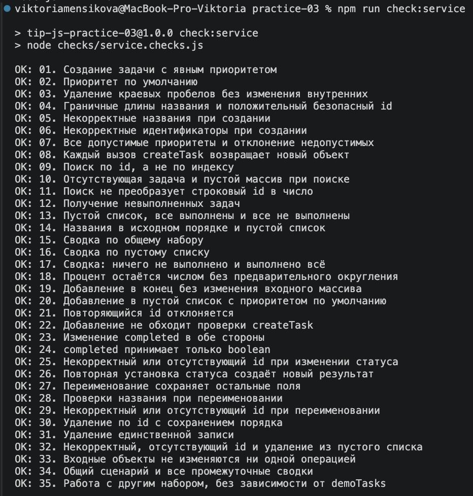

# Практическая работа № 3. Работа с DOM и событиями

## Данные работы

| Поле | Значение |
|---|---|
| Имя | Меньшикова Виктория Даниловна |
| Группа | ЭФБО-06-25 |
| Вариант из ПР2 | Вариант 8: оформление технической документации |
| Node.js | v24.21.0 |
| Браузер | Safari 18.6 |
| Операционная система | MacOS |


## Запуск

Рабочая папка: `practice-03` внутри личного репозитория.

```bash
npm run check:service
npm start
```

Устанавливать зависимости через `npm install` не требуется. Доступны: 

```text
http://127.0.0.1:5503/
http://127.0.0.1:5503/index.html?dataset=variant
http://127.0.0.1:5503/examples/dom-events.html
http://127.0.0.1:5503/checks.html
```

Остановка сервера: `Ctrl+C`. 

## Что перенесено из ПР2

`task-service.js` и `data.js` перенесены из [Практической работы № 2](./practice-02), тестироание пройдено корректно




## Эксперименты

| № | До запуска: прогноз | После запуска: результат | Объяснение |
|---:|---|---|---|
| 1. Отсутствующий элемент и коллекция | querySelector() при отсутствии элемента вернёт null, а querySelectorAll() — пустой NodeList. | ожидание подтвердилось. querySelector() вернул null, querySelectorAll() вернул пустой NodeList, его длина равна 0. | querySelector() возвращает один элемент или null, а querySelectorAll() всегда возвращает коллекцию элементов, которая может быть пустой. |
| 2. dataset и числовой id | значение dataset.taskId будет строкой, после Number() — числом. | значение dataset.taskId будет строкой, после Number() — числом. | значения data-* через dataset читаются как строки, поэтому при необходимости их нужно преобразовывать в число. |
| 3. Статический NodeList | После каждого нажатия кнопки «Добавить запись» количество элементов списка <li> увеличится на один. | После каждого нажатия кнопки «Добавить запись» количество элементов списка <li> увеличится на один. | Изначально в списке была 1 запись. После первого нажатия стало 2 записи, после второго — 3 записи. |
| 4. Строка с HTML-разметкой | HTML-теги будут отображаться как обычный текст. | `<strong>` отображается как текст и не превращает содержимое в жирный текст. | `<strong>` отображается как текст и не превращает содержимое в жирный текст. |
| 5. Распространение события | При клике событие пройдёт через фазы захвата, цели и всплытия. event.target будет указывать на элемент, по которому выполнен клик (lab-label), а event.currentTarget будет указывать на элемент, обработчик которого выполняется в данный момент. | После одного клика получаем: `1. phase=1; target=lab-label; currentTarget=lab-card 2. phase=2; target=lab-label; currentTarget=lab-button 3. phase=3; target=lab-label; currentTarget=lab-card` | Событие распространяется в три этапа: захват (phase=1), достижение цели (phase=2) и всплытие (phase=3). event.target остаётся lab-label, так как именно по нему был выполнен клик. event.currentTarget показывает элемент, обработчик которого выполняется в данный момент: сначала lab-card, затем lab-button, затем снова lab-card. |

## Организация кода


* `task-service.js` — содержит основные операции с задачами: создание, поиск по `id`, изменение статуса, удаление, переименование, а также вычисление общей статистики задач.

* `task-selectors.js` — отвечает за фильтрацию задач. Функция `getVisibleTasks()` возвращает новый массив задач в зависимости от выбранного фильтра: все, невыполненные или выполненные.

* `task-view.js` — отвечает за отображение данных в DOM: создаёт карточки задач, выводит список, обновляет сводку и сообщение о пустом списке. Сводка вычисляется через `getTaskStats()` из `task-service.js`.

* `main.js` — связывает состояние, обработку событий и отображение. Полный текущий список хранится в `currentTasks`, выбранный фильтр — в `currentFilter`. События обрабатываются через `handleTaskListClick()` и `handleFilterClick()`. После изменения данных вызывается `renderApp()`, который обновляет интерфейс.


## Общий сценарий

Ожидания находятся в разделе 6.5 методички. Ниже записываются фактические результаты запуска.

| Шаг | Видимые id | Всего | Выполнено | Осталось | Прогресс | Показано | Сообщение | Совпало с ожиданием |
|---:|---|---|---|---|---|---|---|---|
| 0 | [1, 4, 7, 10] | 4 | 2 | 2 | 50% | 4 | - | С ожиданием совпало|
| 1 | [4, 7] | 4 | 2 | 2 | 50% | 2 | - | С ожиданием совпало|
| 2 | [7] | 4 | 3 | 1 | 75% | 1 | - | С ожиданием совпало|
| 3 | [1, 4, 7, 10] | 4 | 3 | 1 | 75% | 4 | - | С ожиданием совпало|
| 4 | [1, 4, 10] | 3 | 3 | 0 | 100% | 3 | - | С ожиданием совпало|
| 5 | [] | 3 | 3 | 0 | 100% | 0 | - | С ожиданием совпало|
| 6 | [1, 4, 10] | 3 | 2 | 1 | 66,7% | 3 | - | С ожиданием совпало|
| 7 | [] | 0 | 0 | 0 | 0% | 0 | - | С ожиданием совпало|

После перезагрузки: состояние вернулось к первоначальному (шаг 0).

## Индивидуальный вариант

**Вариант 8: подготовка технической документации.**

Исходный набор содержит 6 задач: 11, 23, 37, 41, 58, 64.  
Изначально выполнены задачи 11, 23, 37, а в работе находятся 41, 58, 64.
После переключения `id = 23` задача становится невыполненной. После удаления `id = 37` она полностью исключается из списка.

| Этап | Всего | Выполнено | Осталось | Прогресс | Видимые id |
|---|---:|---:|---:|---:|---|
| До действий | 6 | 3 | 3 | 50.0% | 11, 23, 37, 41, 58, 64 |
| После переключения 23 | 6 | 2 | 4 | 33.3% | 11, 23, 37, 41, 58, 64 |
| После удаления 37 | 5 | 1 | 4 | 20.0% | 11, 23, 41, 58, 64 |
| Итог, фильтр «В работе» | 5 | 1 | 4 | 20.0% | 23, 41, 58, 64 |
| Итог, фильтр «Выполненные» | 5 | 1 | 4 | 20.0% | 11 |

**Проверка:** переключение `id = 23` изменяет только статус этой задачи, а удаление `id = 37` уменьшает общее количество задач с 6 до 5. При смене фильтра общая сводка не меняется — изменяется только список видимых задач.

## Протокол проверки сервиса

Реальный вывод `npm run check:service`. 

```text
viktoriamensikova@MacBook-Pro-Viktoria practice-03 % npm run check:service

> tip-js-practice-03@1.0.0 check:service
> node checks/service.checks.js

OK: 01. Создание задачи с явным приоритетом
OK: 02. Приоритет по умолчанию
OK: 03. Удаление краевых пробелов без изменения внутренних
OK: 04. Граничные длины названия и положительный безопасный id
OK: 05. Некорректные названия при создании
OK: 06. Некорректные идентификаторы при создании
OK: 07. Все допустимые приоритеты и отклонение недопустимых
OK: 08. Каждый вызов createTask возвращает новый объект
OK: 09. Поиск по id, а не по индексу
OK: 10. Отсутствующая задача и пустой массив при поиске
OK: 11. Поиск не преобразует строковый id в число
OK: 12. Получение невыполненных задач
OK: 13. Пустой список, все выполнены и все не выполнены
OK: 14. Названия в исходном порядке и пустой список
OK: 15. Сводка по общему набору
OK: 16. Сводка по пустому списку
OK: 17. Сводка: ничего не выполнено и выполнено всё
OK: 18. Процент остаётся числом без предварительного округления
OK: 19. Добавление в конец без изменения входного массива
OK: 20. Добавление в пустой список с приоритетом по умолчанию
OK: 21. Повторяющийся id отклоняется
OK: 22. Добавление не обходит проверки createTask
OK: 23. Изменение completed в обе стороны
OK: 24. completed принимает только boolean
OK: 25. Некорректный или отсутствующий id при изменении статуса
OK: 26. Повторная установка статуса создаёт новый результат
OK: 27. Переименование сохраняет остальные поля
OK: 28. Проверки названия при переименовании
OK: 29. Некорректный или отсутствующий id при переименовании
OK: 30. Удаление по id с сохранением порядка
OK: 31. Удаление единственной записи
OK: 32. Некорректный, отсутствующий id и удаление из пустого списка
OK: 33. Входные объекты не изменяются ни одной операцией
OK: 34. Общий сценарий и все промежуточные сводки
OK: 35. Работа с другим набором, без зависимости от demoTasks
```

## Протокол браузерных проверок

Реальный текст из блока «Текстовый протокол» на `checks.html`.

```text
OK: Фильтр all возвращает новый массив в исходном порядке
OK: Фильтр pending выбирает невыполненные задачи
OK: Фильтр completed выбирает выполненные задачи
OK: Все три фильтра работают с пустым списком
OK: Фильтрация не меняет входные записи и их порядок
OK: Карточка — li.task-card с числовым id в dataset
OK: Статус невыполненной карточки и aria-pressed согласованы
OK: Статус выполненной карточки и aria-pressed согласованы
OK: В карточке две обычные кнопки с вложенными подписями
OK: Все приоритеты отображаются по установленному словарю
OK: Название с разметкой отображается текстом
OK: Отрисовка списка создаёт карточки в исходном порядке
OK: Повторная отрисовка не накапливает карточки
OK: Контейнер списка и его обработчик сохраняются
OK: Отрисовка пустого массива очищает прежние карточки
OK: Сводка считается по всему списку, отдельно выводится Показано
OK: Пустая сводка не содержит NaN и Infinity
OK: Сообщение для полностью пустого списка
OK: Сообщение для пустого результата фильтра
OK: Появление карточек скрывает прежнее пустое состояние
OK: Приложение: начальный набор и сводка
OK: Приложение: фильтр срабатывает по клику на вложенный span
OK: Приложение: активный фильтр отмечен классом и aria-pressed
OK: Приложение: фильтрация не удаляет скрытые задачи
OK: Приложение: переключение по id, а не индексу массива
OK: Приложение: выполненная задача исчезает из фильтра В работе
OK: Приложение: удаление изменяет данные, а не только DOM
OK: Приложение: клик по названию не изменяет данные
OK: Приложение: после перерисовок одно нажатие — одно изменение
OK: Приложение: удаление всех записей и нулевая сводка
OK: Приложение: нет совпадений — не то же самое, что нет задач
OK: Приложение: неизвестный числовой id не меняет данные
OK: Приложение: id 4abc не превращается в 4
OK: Приложение: неизвестное действие игнорируется
OK: Приложение: после изменения сохраняется клавиатурный фокус
OK: Приложение: новая загрузка возвращает исходное состояние

Всего: 36. Пройдено: 36. Ошибок: 0.
```

## Собственные проверки

| № | Исходное состояние и действия | Ожидаемый результат | Фактический результат | Итог |
|---:|---|---|---|---|
| 1 | Граничное состояние. В наборе есть одна задача. Открыть приложение, выбрать фильтр «Выполненные», затем выбрать «В работе». | При фильтре «Выполненные» отображается задача, если она выполнена. При фильтре «В работе» отображается только невыполненная задача. При отсутствии совпадений появляется сообщение «Нет задач по выбранному фильтру», при этом сама задача не удаляется из набора. | При переключении фильтров список корректно изменяется. Если выбранный фильтр не содержит задач, отображается сообщение «Нет задач по выбранному фильтру», исходные данные сохраняются. | Пройден |
| 2 | Событие и повторная отрисовка. Открыть список из нескольких задач. Несколько раз подряд переключить одну задачу кнопкой «Выполнена», каждый раз дожидаясь обновления карточки. | За одно нажатие статус меняется только один раз. После перерисовки карточки повторного изменения или дублирования обработчика не происходит. | При каждом нажатии статус изменяется один раз. После перерисовки карточки обработчик продолжает работать корректно, дублирования действий не наблюдается. | Пройден |
| 3 | Действие после перехода между фильтрами. Выбрать фильтр «Выполненные», затем перейти в «В работе» и нажать «Выполнена» у одной из отображаемых задач. | Задача изменяет статус, после чего исчезает из фильтра «В работе». Общая сводка пересчитывается, а количество задач в исходном наборе изменяется только согласно выполненному действию. | После нажатия статус задачи изменяется, карточка исчезает из текущего фильтра. Общая сводка и количество видимых задач обновляются автоматически. | Пройден |

## Отладка и клавиатура

Для отладки обработчика `handleTaskListClick` точка останова была установлена на строке: `const button = event.target.closest("button[data-action]");`

При нажатии на кнопку задачи были получены следующие значения:

| Параметр | Полученное значение |
|---|---|
| `event.target` | нажатый `button` или вложенный `span.action-label` |
| `event.currentTarget` | `ul#task-list` |
| `dataset.taskId` | `4` для карточки с `id = 4` |
| числовой `id` | `4` |
| действие | `toggle` или `delete` |
| результат сервиса | `{ ok: true, tasks: [...] }` |

При изменении статуса вызывается `setTaskCompleted()`, а при удалении — `removeTask()`. После успешного выполнения операции новое состояние сохраняется в `currentTasks`, затем вызывается `renderApp()` для повторной отрисовки интерфейса.

**Проверка клавиатурного управления%**
- Enter и Space — активирует выбранную кнопку.
- После изменения статуса фокус возвращается на кнопку `toggle` той же задачи.
- После удаления задачи фокус переводится на соответствующий фильтр, если удалённая карточка больше не существует в DOM.

**Проверка некорректных идентификаторов:**
Для карточки с `data-task-id="777"` выполняется проверка существования задачи. Если задачи с таким `id` нет, сервис возвращает:

```
{
  ok: false,
  error: "Задача с id=777 не найдена"
}
```
Состояние списка при этом не изменяется.

Для карточки с `data-task-id="4abc"` значение не преобразуется в число 4, так как перед преобразованием выполняется проверка:
`/^\d+$/.test(idText)`
Строка `4abc` проверку не проходит, поэтому операция отклоняется, а состояние приложения не изменяется.

## Вид приложения
отображение индивидуальных задач:


отметка о выполнении задачи:


проверки:



## Дополнительное задание
Дополнительное задание не выполнялось

## Вывод

В ходе работы была реализована корректная работа списка задач: фильтрация, изменение статуса и удаление задач по `id`, обновление сводки и пустого состояния, а также сохранение клавиатурного фокуса после перерисовки.

Были исправлены ошибки, связанные с выбором задачи по индексу вместо `id`, обработкой событий, повторной обработкой после перерисовки, некорректными идентификаторами `777` и `4abc`, фильтрацией и обновлением статистики.

Методы `setTaskCompleted()` и `removeTask()` изменяют состояние массива `currentTasks`, а `renderApp()` и функции из `task-view.js` только отображают это состояние в DOM. Поэтому удаление карточки из DOM само по себе не удаляет задачу из данных.
